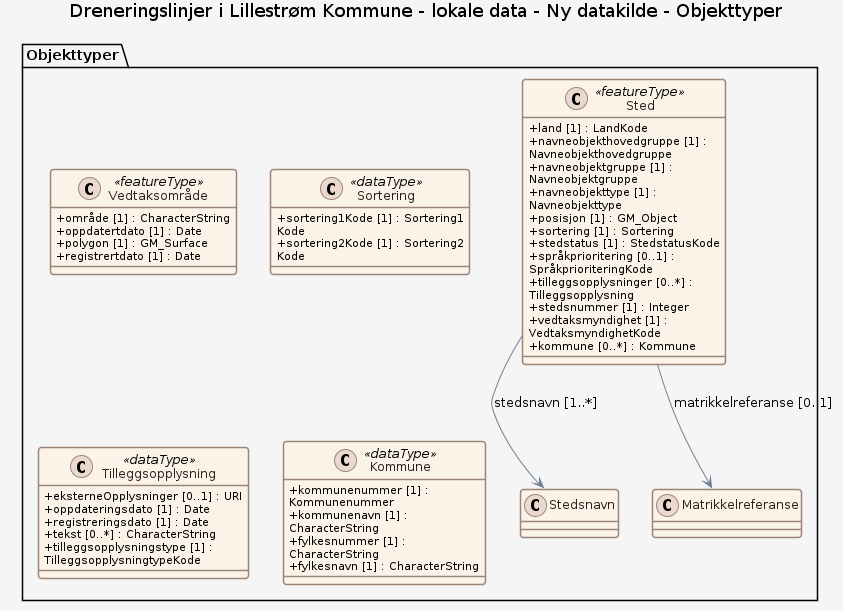

# Produktspesifikasjon: Dreneringslinjer i Lillestrøm Kommune - lokale data

*Dreneringslinjer i Lillestrøm er et datasett som viser modellerte dreneringslinjer. Datasettet viser hvor i terrenget det vil dannes nye dreneringslinjer. Det er ikke tatt hensyn til å stikkrenner og andre kritiske punkt i modelleringen. Datasettet inneholder dreneringslinjer hvor dreneringsarealet er større enn 10.000 m2. Eksisterende FKB-Vann er brent ned i terrengmodellen før beregning, så FKB-Vann har en ekstra vekt ved beregning av disse dreneringslinjene. Data er klipt ut fra Kartverkets datasett "Dreneringslinjer i Oslo og Viken"*

**Nøkkelord:** Det offentlige kartgrunnlaget, fellesDatakatalog, Samfunnssikkerhet

**Emnekategorier:** 

**Geografisk utstrekning**:

- **Vest**: 10.933734
- **Øst**: 11.439506
- **Sør**: 59.75385
- **Nord**: 60.077247

**Geografisk område**:
Lillestrøm kommune

**Tidsmessig utstrekning**:

- **Tidsperiode**:
  - **Fra**: 2023-06-07
  - **Til**: 2023-06-07

## Om spesifikasjonen

> **Denne versjonen av produktspesifikasjonen:**  
> **Opprettet dato:** 2023-06-07 
> **Endret dato:** 2023-06-07 
> **Språk:** nor 
> **Kontaktinformasjon:** Lillestrøm kommune, [Geodata@lillestrom.kommune.no](mailto:Geodata@lillestrom.kommune.no)

## Om produktet Dreneringslinjer i Lillestrøm Kommune - lokale data

> **Romlig representasjonstype:**  
> **Unik identifikator:** aaf53e4a-52d7-40e6-a3fd-186ed1228625 
> **Kontaktinformasjon:** Lillestrøm kommune, [Geodata@lillestrom.kommune.no](mailto:Geodata@lillestrom.kommune.no)
>
> **Romlig oppløsning:**
>
>
>
> **Begrensninger:**
>
> **Juridiske begrensninger**:
>
> - **Tilgangsbegrensninger**: Åpne data
> - **Bruksbegrensninger**: Lisens
> - **Lisens**: No conditions apply to access and use
> - **Lisenslenke**: <http://inspire.ec.europa.eu/metadata-codelist/ConditionsApplyingToAccessAndUse/noConditionsApply>

## Omfang

### Hele datasettet

**Nivå**: dataset

**Nivåbeskrivelse**: Gjelder hele datasettet. Hvis omfang ikke er oppgitt under en overskrift, gjelder teksten for hele datasettet og alle leveranser

### Ny datakilde

**Nivå**: dataset

## Datainnhold og struktur

### Datamodell - Ny datakilde

➡️ [Se full datamodell for omfang "Ny datakilde" (diagram per pakke og objektkatalog)](ny-datakilde/objektkatalog.html)

## Datakvalitet

**Nivå**: dataset

## Vedlikehold

**Vedlikeholdsfrekvens**: Ukjent

## Leveranse

| Tjeneste | Endepunkt | Type | Format | Leveranseenheter |
| --- | --- | --- | --- | --- |
| Geonorge filnedlastning | [Lenke](https://nedlasting.geonorge.no/geonorge/kommunaleDokData/aaf53e4a-52d7-40e6-a3fd-186ed1228625.zip) | GEONORGE:FILEDOWNLOAD |  |  |

## Metadata

**Metadatastandard**: ISO19115:Norsk versjon

**Metadatastandardversjon**: 2003

**Metadatadato**: 2023-11-15

**språk**: nor

**Kontakt**:

- **Organisasjon**: Lillestrøm kommune
- **Logo**: <https://register.geonorge.no/data/organizations/820710592_lillestrom_liten.jpg>
- **Epost**: Geodata@lillestrom.kommune.no
- **rolle**: pointOfContact

**Metadataidentifikator**:

- **Utsteder**: Geonorge
- **kode**: aaf53e4a-52d7-40e6-a3fd-186ed1228625
- **koderom**: <https://kartkatalog.geonorge.no/metadata/>
- **Metadatalenke**: <https://kartkatalog.geonorge.no/metadata/aaf53e4a-52d7-40e6-a3fd-186ed1228625>

